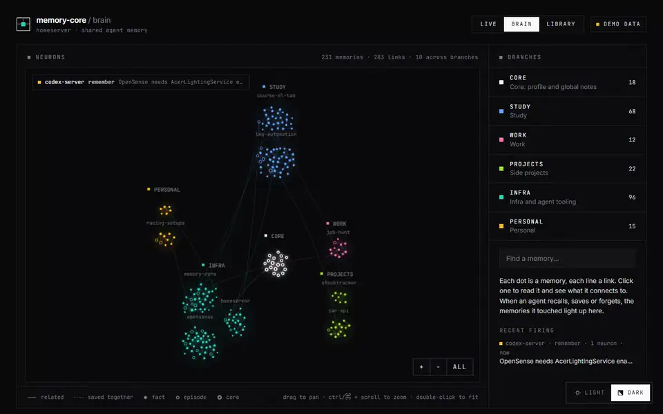
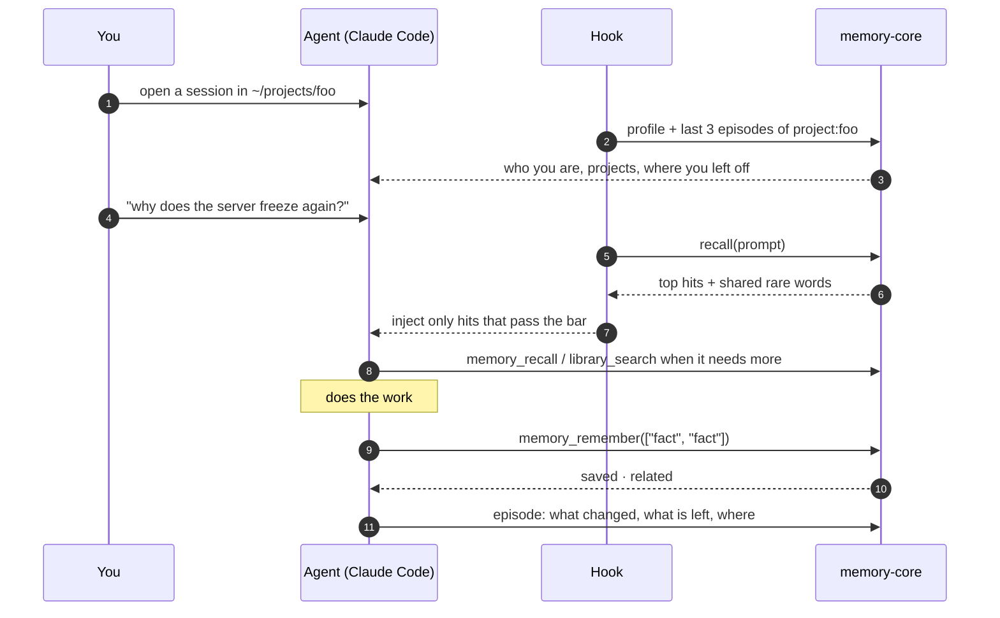
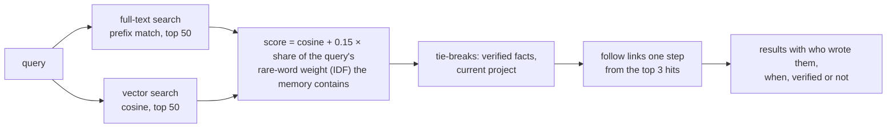
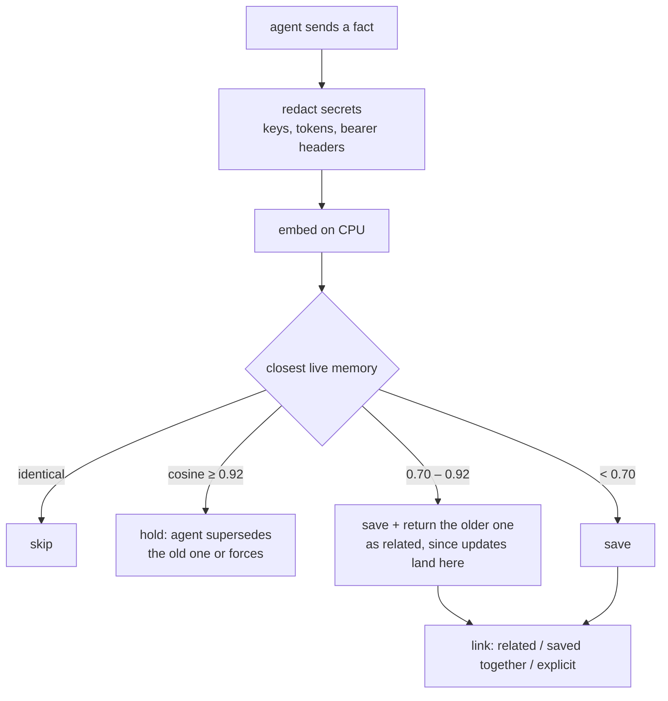
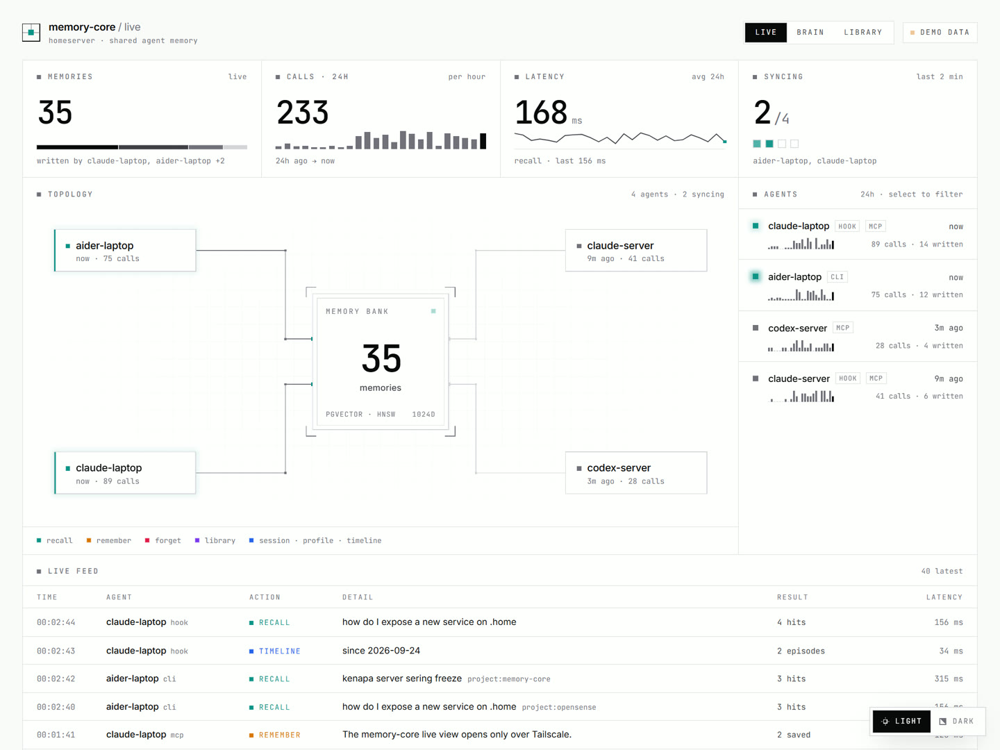
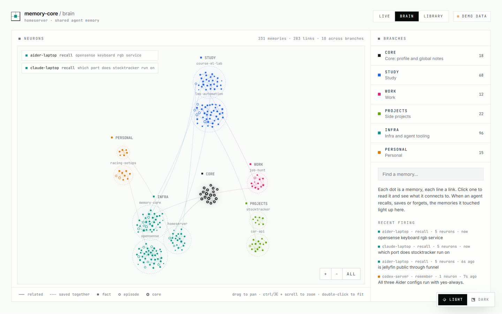
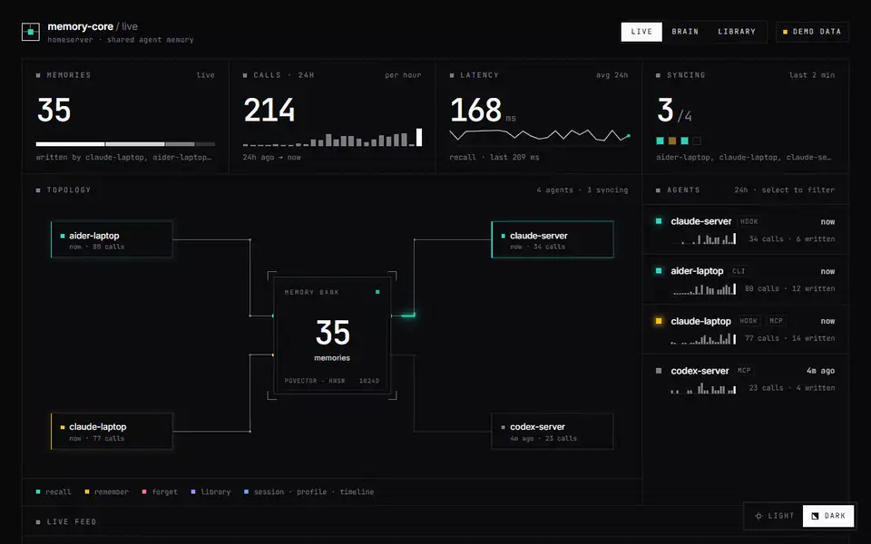
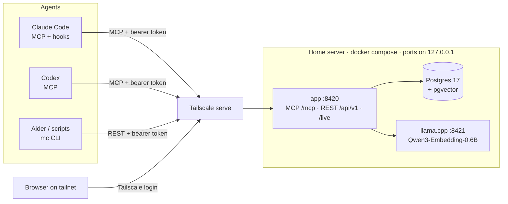

<div align="center">

# memory-core

**One shared, self-hosted long-term memory for every AI coding agent you run.**

[](https://github.com/GodrezJr2/memory-core/actions/workflows/ci.yml)




<sub>The <b>Brain</b> view running on generated demo data (<code>?demo</code>): each dot is a memory, clusters are project branches, and a recall lights up its hits.</sub>

</div>

---

Claude Code, Codex, Aider and anything else that speaks MCP (or can run a shell command) read from and write to the
same memory: facts about your projects, servers, decisions and gotchas, plus a library of skills, docs and saved
references. Start a session in any agent on any machine and it already knows what the last one learned.

It is built to run on a small always-on box (a home server, a mini PC, a cheap VPS) with no LLM on it. Agents send
finished facts. The server redacts secrets, embeds the facts on the CPU and stores them in Postgres with pgvector.

- **Agent-agnostic:** any MCP client works over HTTP, and anything with a shell can use the `mc` CLI or REST.
- **Cheap to run:** three containers, about 2.5 GB of RAM, CPU only.
- **Private by default:** every port binds to `127.0.0.1`. You choose how to expose it (Tailscale, a reverse proxy).
- **Multilingual:** recall works across English and Indonesian out of the box (the embedding model is multilingual,
  and the keyword stop-word list covers both).

> [!NOTE]
> memory-core runs day to day with four agents across two machines and a few thousand memories. Expect a working,
> opinionated tool rather than a polished product: some features (the live view, phone capture) assume Tailscale.

## Why

Each agent session starts from zero. Agents rediscover the same port numbers, re-debug the same quirks and forget
decisions made a week ago. Per-tool memory files (`CLAUDE.md`, `AGENTS.md`) don't carry over between tools or
machines, and they grow until nobody reads them. memory-core is one store every agent shares. It hands each agent only
the few memories that fit the prompt in front of it.

## How it works

### A session, end to end



The hook injects nothing unless a memory shares a *rare* word with the prompt and clears a similarity bar. That keeps
the context small: on 131 hand-labelled prompts it kept 87% of the relevant lines and 20% of the noise.

### Recall: what gets ranked first



### Remember: what happens to a new fact



Nothing is ever deleted: forget and supersede set `valid_to`, so the history stays queryable.

## The UI

A React page served at `/live`, visible only to allow-listed Tailscale logins. No token lives in the browser.

**Live:** every tool call from every agent as it happens. Each call runs along its agent's connector into the memory
bank, and the live feed lists them with latency and results.

<picture>
  <source media="(prefers-color-scheme: dark)" srcset="docs/live-dark.jpg">
  
</picture>

**Brain:** every memory as a neuron, one cluster per branch around the core notes, links drawn as axons. Click a
neuron to read it and walk its links, or filter by branch or text.

<picture>
  <source media="(prefers-color-scheme: dark)" srcset="docs/brain-dark.jpg">
  
</picture>

<details>
<summary>Live view in motion</summary>



</details>

<sub>Screenshots use generated demo data. Run <code>cd web && npm run dev</code> and open <code>/live/?demo</code> to
see the same.</sub>

**Library** (not pictured, since it holds personal data): search skills, starred repos and project docs, and review
saved screenshots and links in an inbox.

## Features

| | |
|---|---|
| **Hybrid recall** | Keyword + meaning, tuned on a real question set (see below). |
| **Dedupe on write** | Near-duplicates are held back, likely updates come back as `related`. |
| **Secret redaction** | API keys, tokens and bearer headers become `[REDACTED:kind]` before storage or logging. |
| **Scopes and tokens** | `global`, `project:<name>`, `agent:<id>`, `session:<name>`. Each agent token carries fnmatch patterns that limit what it reads and writes. |
| **Branches** | Projects grouped into domains (work, study, infra…) from `app/domains.json` or filed by agents themselves. `scope='domain:<name>'` searches one. |
| **Links** | `related` by meaning, `together` when saved in one call, `explicit` when an agent says so. Recall follows them one step. |
| **Library** | Skills (`SKILL.md` folders), starred GitHub repos and project docs, content-addressed. Agents can search them, read one file or pull a whole skill folder on demand. |
| **Saved references** | Screenshots and links from the web app or a phone Shortcut, OCR'd and kept in an inbox until an agent files them. |
| **Live view** | The page above, over server-sent events. |

## Architecture



- **One ASGI app** (`app/server.py`, Starlette + the MCP SDK) serves MCP, REST and the live page.
- **No LLM on the server.** Writing a good fact needs a model, and the agent already has one. The server only
  embeds, ranks and stores.
- **CPU only.** The embedder runs at about 230 tokens/s on an i3, so there is deliberately no reranker.

## Recall quality

`scripts/eval_recall.py` runs a question set through the real recall path and reports hit@k and MRR. The questions
are phrased the way a person actually asks (mixed Indonesian and English), and each lists the memory ids that answer it.

| Corpus | Questions | hit@1 | hit@5 | hit@10 | MRR@10 | median latency |
|---|---|---|---|---|---|---|
| 2,626 memories from real use (13 Nov 2026) | 102 | 0.716 | 0.951 | 0.98 | 0.814 | 168 ms |

This beat the reciprocal-rank fusion used before (hit@1 0.50), which had decayed as the corpus grew because
common-word keyword matches crowded the keyword list. That set refers to private memories, so the repo ships only
an example of the format (`tests/eval/recall_questions.json`). The agent that knew the memories wrote the questions,
so treat the numbers as a regression check, not a benchmark.

## MCP tools

| Memory | Library |
|---|---|
| `memory_profile`: who you are, projects by branch, recent sessions | `library_search`: skills, repos, docs, references |
| `memory_recall`: hybrid search, optional `scope` / `domain:` | `library_categories`: the shelves and when to use each |
| `memory_remember`: save facts, supersede, link | `library_get` / `library_file`: read an item or one file in pages |
| `memory_forget`: retire a memory with a reason | `library_inbox` / `library_view` / `library_review`: file saved references |
| `memory_timeline`: session episodes, newest first | |
| `memory_branches` / `memory_branch` / `memory_branch_review` | |

REST mirrors them under `/api/v1/{profile,recall,remember,forget,timeline}` and `/api/v1/library/*` with the same
token.

## Clients

- **Claude Code hooks** (`clients/claude_code_hook.py`): injects the profile and the project's last episodes at
  session start and matching memories on each prompt. It never injects the same memory twice in a session, and it can
  pull a matching skill into `~/.claude/skills` for that session only.
- **Save checkpoint** (`clients/claude_code_checkpoint.py`): a Stop hook. After real work with nothing saved, it asks
  the agent once to save durable facts and an episode.
- **`mc` CLI** (`clients/mc.py`, stdlib only): profile, recall, remember, library search, skill pull/drop. For agents
  without MCP and for scripts.
- **Library sync** (`clients/library_sync.py`): scans a machine's skills, docs and GitHub stars. It sends a manifest
  of hashes and uploads only what the server lacks.

## Quick start

Requirements: Docker with compose, and about 2.5 GB of RAM for the three containers (their memory limits).
Tailscale is optional; without it, the MCP and REST API still work behind any reverse proxy, but the live view and
phone capture (which authenticate by Tailscale login) stay closed.

```bash
git clone https://github.com/GodrezJr2/memory-core && cd memory-core
mkdir -p data/media data/bundles models
openssl rand -hex 24 > data/pg_password
echo '{"agents": {}}' > data/tokens.json
sudo chown -R 65534 data/media data/bundles      # the app container runs as nobody

# embedding model (~640 MB)
curl -L -o models/Qwen3-Embedding-0.6B-Q8_0.gguf \
  https://huggingface.co/Qwen/Qwen3-Embedding-0.6B-GGUF/resolve/main/Qwen3-Embedding-0.6B-Q8_0.gguf

python3 scripts/mint_token.py claude-laptop --file data/tokens.json   # prints the token once
docker compose up -d --build
tailscale serve --bg --https=8420 http://127.0.0.1:8420             # optional: reach it from your tailnet
```

Check it is up with `curl http://127.0.0.1:8420/healthz`, then mint one token per agent.

### Connect an agent

Claude Code:

```bash
claude mcp add --transport http memory https://<your-host>.ts.net:8420/mcp \
  --header "Authorization: Bearer <token>"
```

Codex (`~/.codex/config.toml`) and other MCP clients take the same URL and bearer header. For agents without MCP:

```bash
export MC_URL=https://<your-host>.ts.net:8420 MC_TOKEN=<token>
python clients/mc.py recall "which port does the api run on"
python clients/mc.py remember "The API runs on port 8080." --scope project:api
```

### Claude Code hooks (optional, recommended)

The hooks make memory automatic: context at session start, relevant memories on each prompt, and a nudge to save
before the session stops. Copy them into `~/.claude/hooks/`:

```bash
mkdir -p ~/.claude/hooks
cp clients/claude_code_hook.py ~/.claude/hooks/memory_context.py
cp clients/claude_code_checkpoint.py ~/.claude/hooks/memory_checkpoint.py
cp clients/mc.py ~/.claude/hooks/mc.py          # lets the hook pull matching skills
```

and register them in `~/.claude/settings.json` (they read the URL and token from the `memory` MCP entry above):

```json
{
  "hooks": {
    "SessionStart":     [{ "hooks": [{ "type": "command", "command": "python3 ~/.claude/hooks/memory_context.py" }] }],
    "UserPromptSubmit": [{ "hooks": [{ "type": "command", "command": "python3 ~/.claude/hooks/memory_context.py" }] }],
    "SessionEnd":       [{ "hooks": [{ "type": "command", "command": "python3 ~/.claude/hooks/memory_context.py" }] }],
    "Stop":             [{ "hooks": [{ "type": "command", "command": "python3 ~/.claude/hooks/memory_checkpoint.py" }] }]
  }
}
```

## Configuration

Environment variables of the `app` service (`compose.yaml`):

| Variable | Default | What it does |
|---|---|---|
| `DATABASE_URL` | built from `PG_HOST` and the `pg_password` secret | Postgres connection string |
| `PG_HOST` | `postgres` | Postgres host when `DATABASE_URL` is unset |
| `EMBED_URL` | `http://embedder:8421` | OpenAI-compatible embeddings server |
| `TOKENS_FILE` | `/data/tokens.json` | agent tokens (SHA-256 hashes only), written by `scripts/mint_token.py` |
| `NEAR_DUPLICATE` | `0.92` | cosine at or above which a new fact is held as a near-duplicate |
| `RELATED` | `0.70` | cosine at or above which the older memory comes back as `related` |
| `CANDIDATES` | `50` | rows taken from each of keyword and vector search |
| `LIVE_VIEWERS` | empty | comma-separated Tailscale logins allowed to open `/live` |
| `MEDIA_DIR` | `/data/media` | images of saved references |
| `BUNDLE_DIR` | `/data/bundles` | skill folders stored as zips |

Files to make your own:

- `compose.yaml`: `LIVE_VIEWERS` and the data paths.
- `app/domains.json`: your own branches (the example ships study, work, projects, infra and personal). Their names
  also pick the Brain view's colours in `web/src/index.css` and `web/src/lib/brain.ts`.
- `app/library_categories.json`: the library shelves. It ships as an example: 18 shelves with the descriptions new
  items are matched against, generic guides, and a few sample entries. Pin your own skills and starred repos to
  shelves under `skills` and `repos`, and write each shelf's `guide` for your agents.
- The `INSTRUCTIONS` text in `app/server.py`, which MCP clients show their agent.

### Swapping the embedder

Any OpenAI-compatible `/v1/embeddings` server works (another llama.cpp model, Ollama, TEI, vLLM, a hosted API): set
`EMBED_URL`. Three things are tied to Qwen3-Embedding-0.6B:

1. **Dimension:** `app/schema.sql` declares `vector(1024)` in three tables. A model with another size needs those
   changed and every memory re-embedded.
2. **Query prompt:** `app/embed.py` prefixes queries with `Instruct: …\nQuery:` (documents go in as-is). Use whatever
   your model's card asks for.
3. **Thresholds:** cosine spreads differ between models. Recalibrate `NEAR_DUPLICATE` (0.92) and `RELATED` (0.70),
   both env vars, plus the hook's injection bars, and check the result with `scripts/eval_recall.py`.

## Development

```bash
pip install -r requirements.txt pytest
python -m pytest tests                 # 94 rule tests, no services needed
cd web && npm ci && npm run dev        # live view; open /live/?demo for generated traffic
MC_URL=... MC_TOKEN=... python scripts/smoke.py   # 46 end-to-end checks against a running server
```

```
app/        server, store (SQL + ranking), rules (scopes, redaction), library, refs, activity feed
clients/    Claude Code hooks, mc CLI, library sync
scripts/    token minting, backup, recall eval, near-duplicate finder, skill update check, smoke test
tests/      unit tests and the eval set format
web/        live view: React 19, Tailwind 4, Framer Motion, d3-force
docs/       README images
```

## Operating

- **Backups:** `scripts/backup.sh` writes a `pg_dump` (without the access log) to `$BACKUP_DIR` and keeps 14 days;
  run it from cron.
- **Safe deploys:** tag the running image before rebuilding (`docker tag memory-core:local memory-core:prev`), then
  build, `docker compose up -d app`, wait for the health check and run `scripts/smoke.py`. If anything fails, tag
  `prev` back and bring the app up again. A change to `app/schema.sql` deserves a dump first.
- **Tokens:** one per agent, so the live view and the access log show who did what, and a leaked token can be rotated
  alone (`mint_token.py <agent-id>` again).

## Contributing

Issues and pull requests are welcome; see [CONTRIBUTING.md](CONTRIBUTING.md). Security reports go through
[SECURITY.md](SECURITY.md).

## Credits

Created by [@GodrezJr2](https://github.com/GodrezJr2), who designed it and directs its development. Most of the code
was written with [Claude Code](https://claude.com/claude-code) and checked against daily use.

## License

[MIT](LICENSE)
